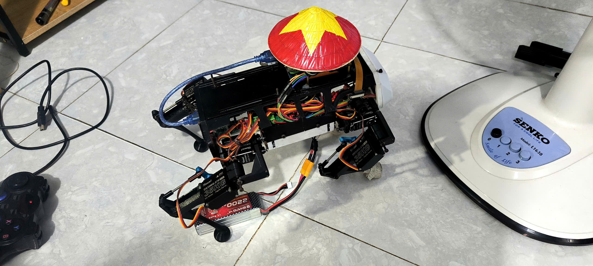
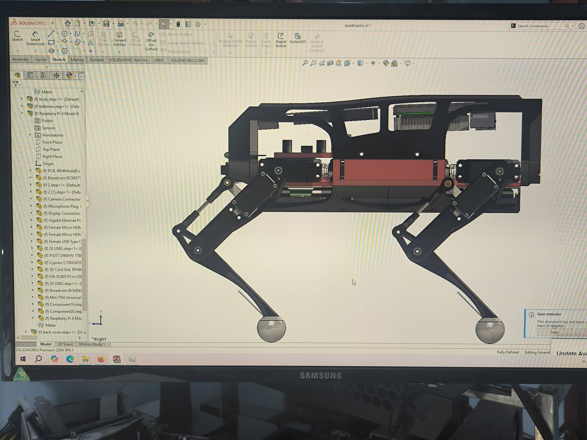
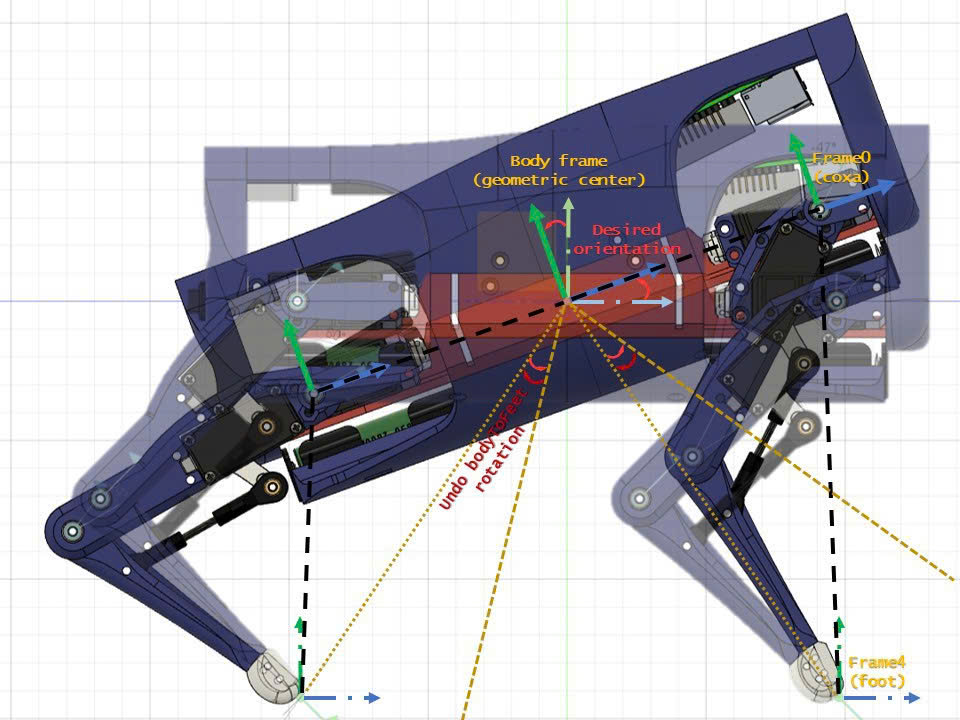

# 12-Servo Quadruped Robot

A quadruped robot project with Python motion control and Arduino sketches. The source includes gait planning, inverse kinematics, center-of-mass stabilization, and routines for dance and LED patterns.

## Repository guide

| Path | Contents |
| --- | --- |
| [main.py](main.py) | Main Python entry point |
| [src](src) | Motion, kinematics, joystick, and communication modules |
| [arduino-code](arduino-code) | Arduino communication and IMU sketches |
| [servo_calibration.py](servo_calibration.py) | Servo calibration script |
| [telemetry](telemetry) | Telemetry files |
| [esquema.jpg](esquema.jpg) | Wiring diagram |

## Prototype video

[Open or download the quadruped video (MP4)](docs/videos/quadruped-demo.mp4)

## Design and motion

| SolidWorks assembly | Body orientation and coordinate frames |
| --- | --- |
|  |  |

| Inverse kinematics | Foot trajectory |
| --- | --- |
| [Joint-angle equations](docs/images/inverse-kinematics.jpg) | [Bézier swing and stance curves](docs/images/foot-trajectory.jpg) |
